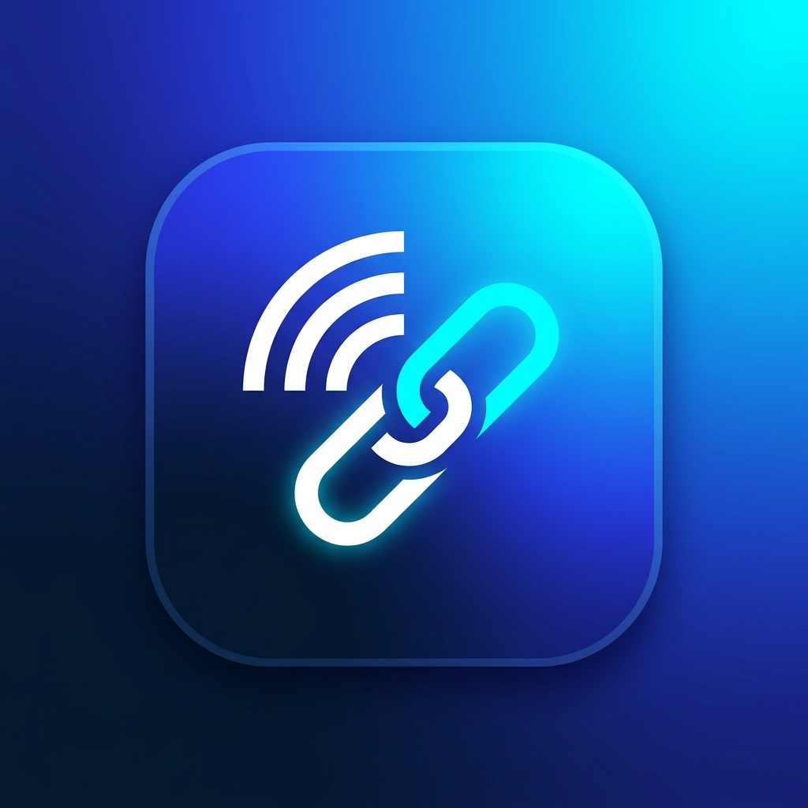

<p align="center">
  
</p>

<h1 align="center">NFC Link Share</h1>

<p align="center">
  <b>Comparte cualquier enlace web tocando otro teléfono celular mediante NFC, sin necesidad de tags ni stickers físicos.</b>
</p>

<p align="center">
  
  
  
  
  
</p>

---

## 📖 Descripción

**NFC Link Share** es una aplicación para Android desarrollada en Kotlin que utiliza la tecnología **Host Card Emulation (HCE)** para convertir tu smartphone en una etiqueta NFC virtual (*NFC Forum Type 4 Tag*).

Permite compartir enlaces web (URLs), perfiles de redes sociales o chats directos con cualquier otro celular (**Android o iPhone**) simplemente acercándolos, de la misma forma en que funciona una tarjeta de presentación digital física, pero directamente desde el hardware del teléfono.

---

## ✨ Características Principales

* 📡 **Emulación HCE Directa:** No requiere etiquetas adhesivas ni accesorios externos; utiliza directamente la antena NFC integrada del celular.
* 🌐 **Compatibilidad Universal:** 
  - **iPhones (iPhone XR en adelante):** Lee el enlace de forma nativa mediante *Background Tag Reading* y despliega la notificación de Safari automáticamente.
  - **Android:** Reconoce el registro NDEF y abre el navegador predeterminado al contacto.
* 🛡️ **Prioridad en Primer Plano (`setPreferredService`):** Evita conflictos o interrupciones con Google Wallet y aplicaciones de pago bancarias mientras la app está activa en pantalla.
* ⚡ **Accesos Rápidos:** Botones preconfigurados para WhatsApp, LinkedIn, Instagram y sitios web personalizados.
* 🟢 **Estado en Vivo:** Indicador visual que informa en tiempo real si el teléfono está emitiendo activamente o si el servicio está detenido.
* ⚠️ **Sensor de Hardware NFC:** Detecta si el chip NFC está desactivado y ofrece un acceso directo a los ajustes del sistema.

---

## 🚀 ¿Cómo se usa?

1. **Ingresa el enlace:** Escribe cualquier URL en el campo de texto (o utiliza uno de los botones rápidos de ejemplo).
2. **Inicia la emisión:** Pulsa el botón **"ACTIVAR Y COMPARTIR"** (el recuadro superior cambiará a verde indicando *EMISIÓN NFC ACTIVA*).
3. **Mantén la pantalla encendida:** Por seguridad del sistema operativo Android, el chip NFC solo responde en modo emulación cuando la pantalla del emisor está activa.
4. **Acerca el otro teléfono:**
   - **En iPhone:** Acerca la parte superior trasera del iPhone a la antena NFC de tu teléfono.
   - **En Android:** Acércalos espalda con espalda.
5. El teléfono receptor mostrará de inmediato una notificación flotante para abrir la página web **sin necesidad de tener ninguna aplicación instalada**.

---

## 🛠️ Arquitectura Técnica

La aplicación implementa el estándar internacional **ISO/IEC 7816-4** y la especificación de **NFC Forum Type 4 Tag** a través del servicio nativo `HostApduService`:

```
Dispositivo Lector (iPhone / Android)                  NFC Link Share (HCE Service)
           |                                                        |
           | ----- SELECT AID (D2760000850101) -------------------> |
           | <---- 90 00 (Tag NDEF Detectado) --------------------- |
           |                                                        |
           | ----- SELECT Capability Container (E1 03) -----------> |
           | <---- 90 00 + CC Mapping Data ------------------------ |
           |                                                        |
           | ----- SELECT NDEF File (E1 04) & READ BINARY --------> |
           | <---- Payload NDEF con URI (https://...) ------------- |
```

---

## 📦 Compilación e Instalación

### Requisitos previos:
* **JDK 17** o superior.
* **Android SDK Platform 35** (Android 15).

### Compilar desde la terminal:
Clona el repositorio y compila el APK en modo debug:

```bash
git clone git@github.com:easy-kid/nfc-url-sharer.git
cd nfc-url-sharer
./gradlew :demo:assemblePhoneDebug
```

El APK resultante se generará en:
```text
demo/build/outputs/apk/phone/debug/ndef_emulation_demo_phone_debug_1.0.0.apk
```

### Instalar en un dispositivo conectado por USB:
```bash
adb install -r demo/build/outputs/apk/phone/debug/ndef_emulation_demo_phone_debug_1.0.0.apk
```

---

## 📄 Créditos y Licencia

* Motor base de emulación HCE derivado de [LuigiVampa92/ndef-emulator](https://github.com/LuigiVampa92/ndef-emulator).
* Actualizaciones a Android 15, integración de prioridad HCE, nuevo diseño de interfaz y diseño de logo por [@easy-kid](https://github.com/easy-kid).
* Licencia bajo [Apache License 2.0](LICENSE.md).
